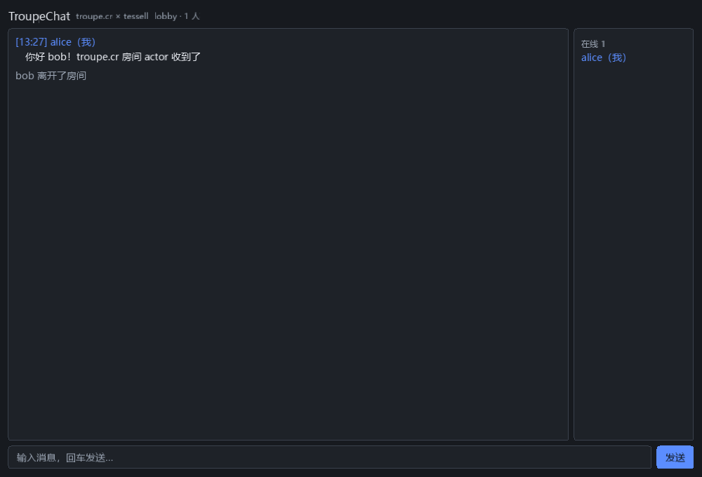

# TroupeChat

一个用 **Crystal** 写的两端聊天室：

- **服务端**：[`troupe.cr`](https://github.com/ShiningRay/troupe.cr) Virtual Actor 框架 ——
  每个房间一个 `RoomActor`（成员/最近消息为 Props，SQLite WAL 持久化；发言以客户端
  `cid` 作幂等键；房间广播经 troupe Outbox 与 Turn 提交同序投递）+ Crystal 标准库
  HTTP/WebSocket 网关。
- **客户端**：[`tessell`](https://github.com/ShiningRay/tessell) retained 自绘 GUI ——
  Kit 组件（Button/Input/Text）+ 自绘聊天记录（换行/吸底/滚轮翻阅），SDL2 + OpenGL
  宿主，WebSocket 收发走后台纤程、每帧泵入 UI。

协议见 [docs/protocol.md](docs/protocol.md)。



## 结构

```
troupe-chat/
├── protocol/   # 共享消息编解码（纯 Crystal，零依赖；两端 path 依赖）
├── server/     # chat_server：RoomActor + WebSocket 网关（依赖 troupe）
└── client/     # chat_client：tessell GUI + WebSocket（依赖 tessell）
```

## 运行

环境：Crystal >= 1.22。Windows 客户端需要 MSYS2 UCRT64（crystal/SDL2/Freetype/HarfBuzz）。

```sh
# 1) 服务端（8077 端口，SQLite 持久化到 chat.db）
cd server && shards install
crystal run src/server.cr -- -p 7777 -d chat.db

# 2) 客户端（另开终端）
cd client && shards install
crystal run src/client.cr -- --server ws://127.0.0.1:7777 --nick alice
```

启动后填写昵称点击「连接」（默认房间 lobby、地址 ws://127.0.0.1:7777），
回车或点「发送」发言；多开几个客户端即可互聊。

### 自动化验证（无人工交互）

```sh
cd server && crystal run src/server.cr -- -p 7777 -d :memory: &
cd client
crystal run src/client.cr -- --autotest --send "hello" --nick alice --frames=150 --screenshot=shot.png
```

`--autotest`：第 5 帧自动连接 → 加入后自动发送 `--send` 文本 → 等待服务端 ack，
stdout 会打 `[autotest] acked: …`；`--frames` 限定帧数，`--screenshot` 落 PNG
（PNG 编码器 vendor 自 tessell `tools/lib/png`，stored zlib），`--screenshot-at=N`
可在第 N 帧中途拍摄（双客户端编排互见截图用）。
另有一组 `CHAT_DEBUG` / `CHAT_TEXT_DEBUG` / `CHAT_CMD_DEBUG` 环境变量开关的
诊断输出（消息 ingest 流 / 文本命令批次 / 绘制命令列表）。

## 测试

```sh
cd protocol && crystal spec   # 编解码
cd server   && crystal spec   # RoomActor 语义 + 网关端到端（13 例）
cd client   && crystal spec   # 状态机（6 例）
```

覆盖要点：join/重名拒绝、发言幂等重放（同 cid 不重复广播）、历史截断、
断线兜底 leave、SQLite 重启恢复、慢消费者剔除路径、协议往返转义。

## 架构要点（troupe.cr 的用武之地）

| 诉求 | troupe.cr 机制 |
|---|---|
| 房间 = 有状态实体 | Virtual Actor：`ActorId("chat","room",房间名)`，按需激活 |
| 消息顺序 | 每房间 strict Turn 串行；广播经 Outbox 与提交同序 |
| 不丢不重 | `say.cid` 幂等键（重放首次结果）；Outbox 至少一次 + 两端去重 |
| 重启恢复 | Props（成员/最近 200 条消息）随 Turn 原子落 SQLite，重开即回放 |
| 可观测 | `stage.on_trace` / Director `/health /metrics`（`--metrics-port`） |

网关（`server/src/chat/gateway.cr`）是唯一粘合层：WebSocket 会话 ⇄ typed Agent 调用；
事件回放 → 有界 per-connection mailbox（慢消费者限时剔除，背压隔离）。

## 已知限制

- 单进程、单节点；troupe 的多节点接管（PostgreSQL Provider）尚未接入。
- 客户端断线后不自动重连（显示「连接断开，请重试」）。
- 客户端 IME 组合输入依赖 tessell 当前限制（仅已提交文本）。
- 广播 at-least-once：崩溃重放时网关按 `event_id` 去重，极端情况下可能重复可见。
- `--autotest` 多进程编排下偶见首条发言回声未上屏（单人场景与全部 spec 均无法
  复现，疑与测试进程退出时序相关；手动使用未观察到）。诊断开关见上文。

## License

MIT，见 [LICENSE](LICENSE)。第三方组件许可随上游（troupe.cr / tessell / SDL2 / FreeType / HarfBuzz）。
